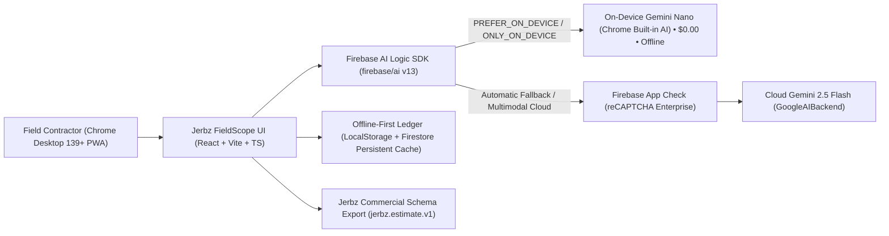

# Jerbz™ FieldScope — Hybrid AI Jobsite Estimator

**Offline-first field service jobsite estimator powered by Firebase AI Logic Hybrid Inference (On-Device Gemini Nano + Cloud Gemini 2.5 Flash fallback).**

Built for the **#BuildHybridAI 2026 — Firebase Hybrid AI Hackathon** and architected as an open-source (Apache-2.0) companion module compatible with the **Jerbz™** commercial field-service management platform (`jerbz.estimate.v1` JSON schema).

---

## Why Hybrid AI for Field Service?

HVAC technicians, electricians, and plumbers routinely work in **sub-basements, mechanical vaults, and rooftop decks with zero cell signal**. Cloud-only AI tools fail right when contractors need them most—and running routine text structuring on cloud APIs burns unnecessary token spend.

**Jerbz™ FieldScope** solves this with **Firebase AI Logic Hybrid Inference (`firebase/ai`)**:

1. **Offline Scope & Material Extraction (`PREFER_ON_DEVICE` / `ONLY_ON_DEVICE`)**
   - Turns messy dictated or typed jobsite notes into structured JSON (`title`, `tradeCategory`, `priority`, `estimatedLaborHours`, itemized `materials[]` with qty, unit, and unit price) using **Chrome Built-in Gemini Nano** at **$0.00 cloud cost** and zero network dependency.
2. **Streaming Client Quote Drafting (`generateContentStream`)**
   - Streams a concise, SMS/email-ready client quote directly on-device, keeping private client details local.
3. **Multimodal Supply Receipt Scanner (`PREFER_ON_DEVICE` → Cloud Fallback)**
   - Upload or snap a supply-house receipt photo. Firebase AI Logic automatically routes on-device if supported, or seamlessly falls back to **Cloud Gemini (`gemini-2.5-flash`)** protected by **Firebase App Check**.
4. **Live Hybrid Telemetry & ROI Ledger**
   - Displays real-time `result.response.inferenceSource` (`ON_DEVICE` vs `IN_CLOUD`), latency (ms), network status (`Online` vs `Offline (Dead Zone)`), and cumulative cloud spend avoided.
5. **Offline-First PWA & Jerbz Schema Export**
   - Persists estimates offline (LocalStorage + Firestore persistent local cache when configured) and exports `jerbz.estimate.v1` JSON directly compatible with Jerbz Enterprise & Standard Edition.

---

## Architecture



---

## Quick Start

### 1. Enable Chrome Built-in Gemini Nano (Chrome Desktop 139+)

1. Open **Google Chrome 139+** on macOS, Windows, or Linux (with >=4GB VRAM or >=16GB RAM and >=22GB free disk).
2. Navigate to `chrome://flags/#prompt-api-for-gemini-nano-multimodal-input` and set to **Enabled**.
3. Navigate to `chrome://flags/#optimization-guide-on-device-model` and set to **Enabled BypassPerfRequirement**.
4. Restart Chrome.
5. Visit `chrome://on-device-internals` to verify Gemini Nano model status (or click **Init Nano** in the FieldScope header to trigger download with live progress).

### 2. Install & Run Locally

```bash
npm install
cp .env.example .env
npm run dev
```

> **Tip:** Even before configuring `.env`, you can test `ONLY_ON_DEVICE` mode locally in Chrome with Gemini Nano enabled.

### 3. Enable Firebase AI Logic (Cloud Fallback + Hosting)

1. Create a dedicated Firebase project (e.g., `jerbz-hybrid-ai`) in the [Firebase Console](https://console.firebase.google.com/).
2. Enable **Firebase AI Logic** (Gemini Developer API):
   ```bash
   npx -y firebase-tools@latest login
   npx -y firebase-tools@latest use --add
   npx -y firebase-tools@latest init ailogic
   ```
3. Register a Web App in Project Settings and copy the config values into `.env`.
4. (Recommended) Enable **Firebase App Check** with **reCAPTCHA Enterprise** and add your site key to `VITE_RECAPTCHA_ENTERPRISE_SITE_KEY` (keep `VITE_APPCHECK_DEBUG=true` for localhost testing).
5. Deploy to Firebase Hosting:
   ```bash
   npm run build
   npx -y firebase-tools@latest deploy --only hosting
   ```

---

## Airplane Mode Demo Script (< 3 Minutes)

1. **Online Setup**: Open FieldScope in Chrome, confirm `Gemini Nano: available` and `InferenceMode: PREFER_ON_DEVICE`.
2. **Simulate Basement Dead Zone**: Toggle DevTools Network -> **Offline** (or turn off Wi-Fi). The header flips to `Offline (Dead Zone)`.
3. **Offline On-Device Extraction**: Select the **HVAC Rooftop Compressor** preset and click **Extract Scope & Materials**. Watch the badge show `⚡ ON_DEVICE • $0.00` with structured materials and totals populated completely offline.
4. **Offline Streaming Client Quote**: Click **Draft Client Quote (Stream)** — streams locally with Gemini Nano.
5. **Back Online → Multimodal Cloud Fallback**: Re-enable network, switch to `PREFER_IN_CLOUD` (or upload a supply-house receipt photo), and watch Firebase AI Logic seamlessly route to `☁️ IN_CLOUD (gemini-2.5-flash)` while the Telemetry Log tracks both edge and cloud runs.
6. **Export to Jerbz**: Click **Export Jerbz JSON** to download the `jerbz.estimate.v1` payload ready for Jerbz Enterprise / Standard Edition.

---

## License

Licensed under the **Apache License, Version 2.0**. See [LICENSE](./LICENSE) for details.
